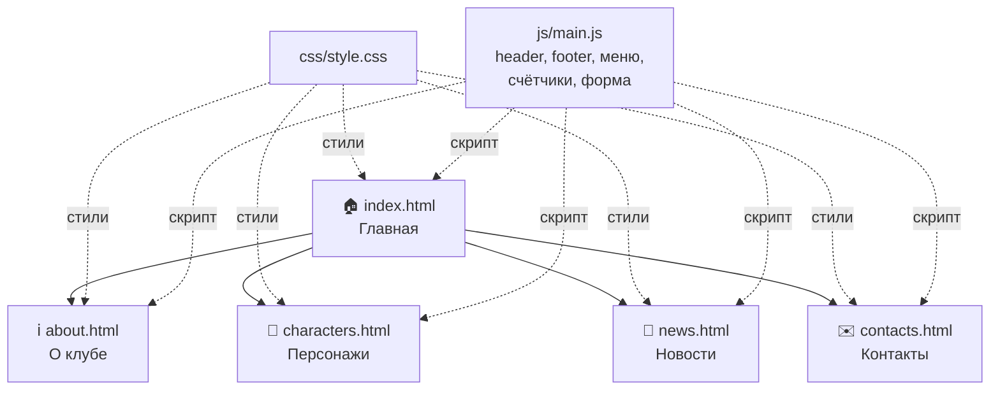

# 🐎 Uma Club «Финиш»

Статический сайт фан-клуба **Umamusume: Pretty Derby**. Проект сделан на чистом HTML, CSS и JavaScript, без фреймворков и сборщиков.

🔗](https://ihttps://nikacod.github.io/Umamusume-Pretty-Derpy-Club/

---

## 📖 О проекте

Сайт рассказывает о клубе любителей игры и аниме Umamusume: новости, персонажи, информация о команде и форма обратной связи для тех, кто хочет вступить.
ite)
;
- потренироваться в вёрстке и работе с Git.

## ✨ Возможности

- 📱4F26?logo=html5&logoCol корректно выглядит на телефоне, планшете и компьютере
- 🧭me: Pretty Derby**. Проект сна всех страницах (подключаются через JS)
- 📍уба **Umamusume: Pretty Derby**. Проект сделан на телефоне превращается в бургер-меню
- 🏇клуба **Umamus бегущие лошадки на главной, счётчики статистики, плавные наведения на карточки
- ✉️т сделан на чистом HTML, Cс проверкой полей и сообщением об успехе
- ♿ Видимый фокус для клавиатуры и поддержка сделан на чистом HTML, CS
## 🗂 Страницы

| Файл | Страница | Что внутри |
|------|----------|------------|
|т сделан на чи| Главная | Hero-секция, последние новости, быстрые ссылки, статистика |
|y**. Проект сд| О клубе | Описание проекта, цели и задачи, команда, история разработки |
|*. Проект сделан на| Персонажи | Карточки героинь |
| сайт фан-клу| Блог и новости | Лента записей клуба |
|н-клуба **Umamusu| Контакты | Форма обратной связи и контактные данные |

## 📁 Структура проекта
оект сделан на чистом HTML, CSS и JavaScript, без фреймворков и сборщиков.

-b «Финиш»
 переменные, Flexbox, Grid, медиазапросы,ан-клуба **Uma- 🐎 Uma Club «Финиш»

 вставка общих блоков, меню, счётчики, валидация формы
-usume: Pretty Derb Nunito и Unbounded
-

Статический сайт хостинг

## 🚀 Как запустить локально

1. Склонируй репозиторий:
  y Derby**. Проект сделан на чистом HTML, CSS и JavaScript, без фреймворков и сборщиков.
2. Открой папку в VS Code.
3. Запустийт фан-клуба *через расширениеиниш»

Статически(правая кнопка → *Open with Live Server*) или просто открой файл в браузере двойным кликом.

Устанавливать ничего не нужно.

## 🔧 Git workflow

- Веткаов.

![H стабильная версия, из неё публикуется сайт на GitHub Pages
- Коммиты делаются с понятными сообщениями, например и JavaScript, без ф# 🐎 Uma Club «Финиш»

Статический сайт фан-клуба **Umamusume: Pret
## 🎨 Дизайн

Палитра вдохновлена ипподромом:

| Цвет | Значение | Где используется |
|------|----------|------------------|
| 🟢 Газон |рков и сбор| Hero, заголовки страниц |
| 🌲 Тёмная трава |ба **Umamus| Header, footer |
| 🌸 Сакура |ий сайт фан| Активная ссылка, теги |
| 🟡 Золото | фан-клуба | Кнопки, цифры статистики |
| 🍑 Шёлк |фан-клуба *| Фон страниц |

## 👥 Команда

| Участник | Роль |
|----------|------|
| [Вероника](https://github.com/NikaCod) | Разработка, вёрстка, тексты |

## 📜 Лицензия и отказ от ответственности

Проект учебный и некоммерческий. Это неофициальный фан-сайт, он не связан с Cygames и не использует их изображения или логотипы. Umamusume: Pretty Derby является собственностью соответствующих правообладателей.
